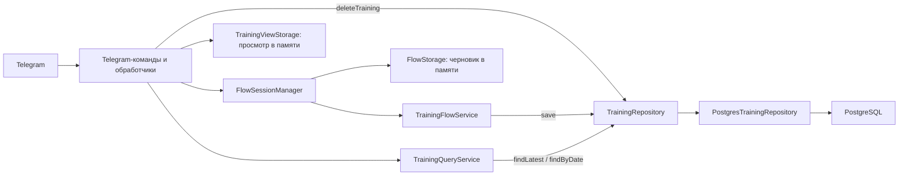

# Архитектура приложения

[README](../README.md) · [Пользовательские пути](user-flows.md) · [Разработка](development.md) · [Развёртывание](deployment.md)

Morning Pilates Bot — одно JVM-приложение: HTTP-сервер Ktor и Telegram-бот
с long polling. PostgreSQL хранит пользователей и сохранённые тренировки;
незавершённое создание и контекст просмотра остаются в памяти процесса.
Пользовательские переходы описаны отдельно в [user-flows.md](user-flows.md).

## Компоненты и зависимости

Схема показывает путь вызовов; интерфейсы репозиториев не зависят от их
PostgreSQL-реализаций. Компоненты явно собираются в `bootstrap`: DI-контейнер
или отдельный command framework для удаления не используются.

| Пакет | Ответственность |
|---|---|
| `bootstrap`, `config` | Чтение настроек, сборка компонентов, запуск и освобождение ресурсов |
| `telegram.command` | `/start`, `/help`, `/cancel`, `/cancel_all` |
| `telegram.training.command` | Вход в создание и два режима просмотра |
| `telegram.training.creation` | Ввод, вопросы, кнопки и регистрация сообщения создания |
| `telegram.training.view` | Просмотр, поиск по дате, навигация, подтверждение и результат удаления |
| `telegram.training.reply` | Общий тип ответа и HTML-формат сохранённой карточки |
| `telegram.flow`, `telegram.api` | Координация отмены и технические операции Telegram |
| `flow`, `flow.model`, `flow.session` | Общие контракты обработчиков, событий, результатов и сессий |
| `training`, `user` | Прикладные модели и контракты репозиториев, сценарий создания и сервис чтения |
| `infrastructure.persistence`, `infrastructure.security` | jOOQ/JDBC, пул, миграции, PostgreSQL и защита Telegram ID |
| `health` | HTTP-маршрут `/health` |

`telegram.training` — интерфейс к предметной области, а не вторая доменная модель.
[Архитектурные тесты](../src/test/kotlin/morningpilates/architecture/ArchitectureTest.kt)
контролируют границы пакетов; бизнес-код не должен зависеть от Telegram-обработчиков
или PostgreSQL-реализаций. Пустые каркасы `Technique`, `TechniqueService` и
`TechniqueRepository` не являются отдельной реализованной библиотекой техник.

## Запуск и остановка

[ApplicationConfiguration](../src/main/kotlin/morningpilates/bootstrap/ApplicationConfiguration.kt)
сначала проверяет и создаёт защиту Telegram ID, затем читает настройки Telegram
и БД. [PostgresDatabase](../src/main/kotlin/morningpilates/infrastructure/persistence/PostgresDatabase.kt)
создаёт HikariCP и выполняет Flyway перед запуском бота. Ошибка ключей, подключения
или миграции не должна маскироваться успешным запуском polling.

Один `PostgresTrainingRepository` передаётся в сценарий создания и сервис чтения.
Его `delete` передаётся в `TelegramBot` как функция
`(TelegramUserId, TrainingId) -> Result<Boolean>` через bootstrap. Новый сервис
удаления и изменение `TrainingQueryService` для записи в БД не требуются.

[ApplicationLifecycle](../src/main/kotlin/morningpilates/bootstrap/ApplicationLifecycle.kt)
управляет запуском и остановкой бота и закрытием БД, включая неудачный старт.
`/health` сообщает о работе HTTP-сервера, а не о доступности Telegram или БД.
Настройки фактического сервиса Render, secrets и статус деплоя не выводятся из
наличия этих классов: это отдельная эксплуатационная проверка.

## Создание: доменный Flow

[TrainingFlowState](../src/main/kotlin/morningpilates/training/TrainingFlowState.kt)
описывает ожидание даты, времени, выбора и ввода техник, описаний, заметки,
подтверждения и состояние `Saving`. Данные постепенно собираются в
`TrainingDetails`; названия и описания техник — в `TechniqueDraft`.

[TrainingFlowService](../src/main/kotlin/morningpilates/training/TrainingFlowService.kt)
реализует общий `FlowHandler`. Он обрабатывает ввод и возвращает `FlowResult`:
`Transition`, `Rejected`, `Completed` или `Cancelled`. Последние два — результаты,
а не сохранённые терминальные состояния сессии.

[FlowSessionManager](../src/main/kotlin/morningpilates/flow/session/FlowSessionManager.kt)
выбирает единственный подходящий обработчик и условно применяет результат
к ожидаемой сессии. Переход в `Saving`, помеченный `AwaitingContinuation`, вызывает
один внутренний `Continue`. Менеджер не выполняет бесконечную цепочку продолжений.
На успешном завершении или отмене сессия удаляется из `FlowStorage`.

`UserSession` содержит состояние, время создания и `SessionId`. ID тренировки
для сохранения выводится из идентификатора этой сессии: повтор той же операции
сохранения использует прежний ID. Ошибка БД возвращает создание к подтверждению
с теми же данными; успешное сохранение завершает Flow до отображения итога.

В Telegram текст принимается только на шагах текстового ввода. Вопросы с выбором
обслуживаются callback-кнопками. Валидация даты общая для создания и поиска:
[TrainingDateParser](../src/main/kotlin/morningpilates/training/TrainingDateParser.kt).

## Три вида временного состояния

| Хранилище | Что хранится | Когда прекращает использоваться |
|---|---|---|
| `FlowStorage` / `InMemoryFlowStorage` | Доменная сессия создания пользователя | Завершение, отмена, сброс или рестарт |
| `TrainingCreationMessageSessionStorage` | Связь сессии с сообщением, токен вопроса и разрешённые callback | Смена вопроса, завершение, сброс или рестарт |
| `TrainingViewStorage` | Активное сообщение просмотра, токен, действия, данные просмотра и удаления | Смена/закрытие просмотра, сброс или рестарт |

`ActiveTrainingView` содержит `dateSearch`, `latestTraining`, `deletionTarget`
и `deletionOutcome` наряду с чатом, сообщением и авторизацией действий.
`TrainingDateSearch` хранит дату, список, индекс, предупреждение и признак ошибки
загрузки; отсутствие даты означает ожидание её ввода.

Один просмотр принадлежит одному пользователю и переиспользуется между
`/training_get_last` и `/training_get_date`. Просмотр последней может сосуществовать
с черновиком; поиск по дате при создании блокируется. При ожидании поисковой даты
обработчик создания пропускает текст, чтобы не выдать второй ответ.

`/training_add` закрывает просмотр, но не перезаписывает уже существующий черновик.
Повторная команда присылает новый видимый вопрос его текущего шага.
`/cancel` сначала закрывает просмотр, иначе передаёт отмену Flow.
`/cancel_all` сбрасывает оба контекста напрямую; это не откат транзакции БД.

## Отображение и авторизация кнопок

Кнопка разрешает действие только в контексте текущего пользователя, чата,
сообщения, токена и набора разрешённых действий. При изменении подтверждения,
режима или поисковой карточки устаревшая кнопка не получает права на новое действие.
Префикс запуска в токене позволяет отличать распознанные кнопки прошлого процесса.
[CallbackAcknowledgement](../src/main/kotlin/morningpilates/telegram/api/CallbackAcknowledgement.kt)
организует штатное подтверждение callback и уведомление о прежнем запуске.

Обычный [TrainingView](../src/main/kotlin/morningpilates/telegram/training/view/TrainingView.kt)
сначала показывает новое содержимое, затем условно заменяет регистрацию.
При отказе редактирования навигация не должна продвинуться на непоказанную карточку.
Подтверждённое отсутствие сообщения допускает отправку замены; неуспешная отправка
не создаёт регистрацию вымышленного сообщения.

**Необратимые результаты обрабатываются иначе.** Принятая отмена удаления сначала
инвалидирует старое подтверждение. Успешное удаление сначала очищает цель и обновляет
снимок в памяти, и только затем отображается. Используются `showCommittedTrainingViewContent`
и фиксация результата в `completeTrainingDeletion`. Отказ Telegram не возвращает
удалённую запись и разрешение на прежнее подтверждение. Если экран не обновился,
восстановление выполняется командами; фоновая гарантированная доставка не реализована.

При закрытии просмотра сначала удаляется регистрация, затем выполняется попытка
удалить сообщение; при отказе — снять inline-кнопки. Даже если обе операции Telegram
не удались, оставшиеся кнопки не получают авторизацию. Общая логика —
[TelegramMessageCleanup](../src/main/kotlin/morningpilates/telegram/api/TelegramMessageCleanup.kt).

## Сохранённые данные

Схема создаётся [миграциями](../src/main/resources/db/migration):

| Таблица | Содержимое |
|---|---|
| `users` | UUID пользователя, зашифрованный Telegram ID, lookup-значение, `is_admin` |
| `trainings` | UUID записи, владелец, дата, время, заметка, `created_at` |
| `training_techniques` | UUID элемента, тренировка, `position`, название и необязательное описание |

`V1` создаёт таблицы, `V2` добавляет `is_admin`, `V3` — `created_at` тренировки.
Поле `is_admin` само по себе не означает, что команды дневника ограничены
администратором: в текущих обработчиках такого условия нет.

[PostgresTrainingRepository](../src/main/kotlin/morningpilates/infrastructure/persistence/PostgresTrainingRepository.kt)
выполняет синхронные параметризованные запросы через jOOQ `DSLContext`, без
генерации классов таблиц. Контракт возвращает `Result`; ошибки не заменяются
пустыми списками или успешным удалением.

### Сохранение

`save(user, trainingId, details)` создаёт пользователя через `getOrCreate`
в той же транзакции, что тренировку и техники. Повтор ID не вставляет дубликат:
после конфликта проверяются владелец и полное содержимое записи, включая порядок
техник. Другие данные или другой пользователь при том же ID дают ошибку.
Это идемпотентность сохранения конкретного ID, не запрет одинаковых тренировок
с разными ID и не универсальная гарантия exactly-once для Telegram.

### Чтение

`TrainingQueryService` делегирует `findLatest` и `findByDate` репозиторию.
Чтение не создаёт пользователя.

- `findLatest`: `training_date DESC`, затем `start_time DESC`, `created_at DESC`,
  одна запись; отдельно загружаются её техники.
- `findByDate`: точная дата и владелец, `start_time DESC`, `created_at DESC`;
  один запрос при пустом результате, два при непустом — тренировки и все их техники.
  Сборка списка выполняется в памяти; внутри неё нет запроса на каждую тренировку.

Техники восстанавливаются по `position`. Полное совпадение всех ключей сортировки
не имеет дополнительного согласованного критерия. Снимок просмотра означает
сохранённый список в памяти, а не транзакционный snapshot двух SQL-запросов чтения.
Дальнейшая навигация не обращается к БД; новый поиск и Retry обращаются.

### Удаление

`delete(user, trainingId): Result<Boolean>` сначала ищет собственную запись через
`telegram_id_lookup` и блокирует её `FOR UPDATE OF t`. В одной транзакции удаляются
техники и родительская строка. В схеме нет `ON DELETE CASCADE`; ответственность
за порядок и атомарность лежит на этой операции. Пользователь не удаляется.

`true` означает удаление, `false` — отсутствие собственной записи с таким ID,
`failure` — ошибку. Чужая и отсутствующая запись не различаются результатом `false`.
`runCatching` находится снаружи транзакции, чтобы ошибка приводила к откату.

[TrainingViewDeletion](../src/main/kotlin/morningpilates/telegram/training/view/TrainingViewDeletion.kt)
фиксирует показанную запись как цель подтверждения. Retry удаления использует тот
же ID. В поиске по дате после успеха запись исключается из списка без перечитывания;
для последней выполняется `findLatest`. Ошибка этого чтения не приводит к новому
удалению. Результаты `Failed`, `Deleted`, `Unavailable` различаются в состоянии и UI.

## Защита данных и эксплуатационные границы

[TelegramIdProtector](../src/main/kotlin/morningpilates/infrastructure/security/TelegramIdProtector.kt)
шифрует Telegram ID с AES-256-GCM и вычисляет lookup через HMAC-SHA256 с другим
ключом. Оба ключа — по 32 байта, задаются извне и сохраняются между запусками.
Это **не шифрование всего дневника**: названия техник, описания и заметки хранятся
обычным текстом. Ротация ключей, удаление профиля и управление доступом оператора
к самой БД этой защитой не реализуются.

Для текущего MVP используется один активный процесс бота на токен: временные
состояния не разделяются между экземплярами. Нельзя рассчитывать на корректный
перенос диалога между репликами. Рестарт сбрасывает черновики и просмотры, но не
сохранённые данные PostgreSQL. Очистка сообщений, длина карточек и доставка зависят
от Telegram; outbox, автоматическое разбиение длинной карточки и персистентные
сессии отсутствуют. `/cancel_all` не гарантирует отмену начатого сохранения.

## Проверки

Доменное поведение проверяется обычными тестами, Telegram-пути — через реальный
Dispatcher с тестовым HTTP-транспортом. PostgreSQL/Testcontainers проверяет схему,
фильтрацию, порядок, число запросов, идемпотентность сохранения, принадлежность
удаляемой записи и откат связанных данных. Это не замена ручной проверке клиента
Telegram и фактического развёрнутого экземпляра. Команды — в
[разделе тестирования](development.md#тесты-и-анализаторы).
