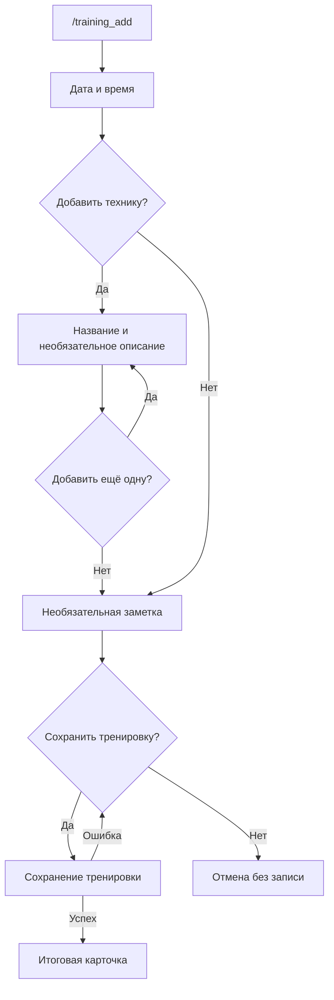
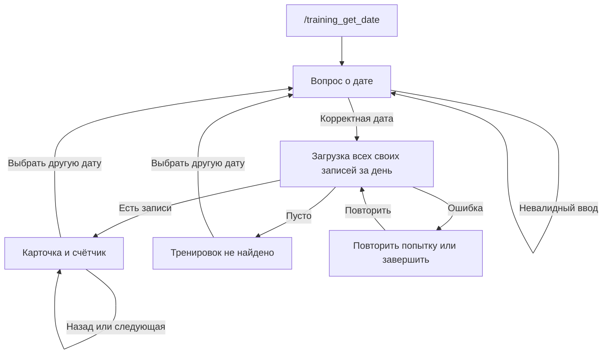
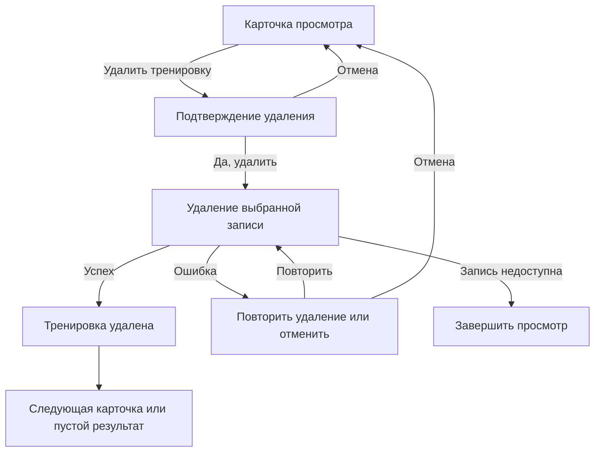

# Пользовательские пути MVP

[README](../README.md) · [Архитектура](architecture.md) · [Разработка](development.md) · [Развёртывание](deployment.md)

## Начало работы

Дневник работает в личном чате. `/start` показывает приветствие, `/help` — справку.
Эти две команды не сбрасывают текущий сценарий.
Полный список команд приведён в [README](../README.md#команды).

В сценариях дневника вопросы и карточки редактируются в одном активном сообщении.
Повторный `/training_add`, восстановление отсутствующего сообщения и подтверждение
`/cancel_all` создают новые сообщения. Старые сообщения могут остаться
в чате, если Telegram отказал в очистке.

## Создание тренировки

**Вход:** `/training_add`. У пользователя может быть только один незавершённый
черновик. Команда сначала закрывает активный просмотр.

| Шаг | Действие пользователя | Результат |
|---|---|---|
| Дата | Ввести дату проведения | Вопрос о времени |
| Время | Ввести время начала | «Добавить технику?» |
| Техники | «Да» — ввести название; «Нет» — пропустить | Для названия появляется вопрос об описании |
| Описание | «Да» — ввести описание; «Нет» — оставить без описания | «Добавить ещё одну технику?» |
| Ещё техника | «Да» — повторить ввод; «Нет» — закончить список | Вопрос о заметке |
| Заметка | «Да» — ввести заметку; «Нет» — пропустить | «Сохранить тренировку?» |
| Подтверждение | «Да» | Сохранение тренировки и итоговая карточка |
| Отказ от сохранения | «Нет» | Создание отменяется без сохранения |

Техники могут повторяться по названию: это отдельные элементы списка.
Тренировка без техник также допустима. Если пользователь согласился ввести
название, описание или заметку, пустой текст отклоняется; необязательные поля
пропускаются соответствующей кнопкой, а не пустым сообщением.

На шагах с выбором используются inline-кнопки «Да» и «Нет», а не текстовые ответы.
Обработанный ввод удаляется после успешного показа следующего вопроса или ошибки
валидации. Если ответ не появился, введённые данные уже могли попасть в черновик.
Вызовите `/training_add`, чтобы увидеть текущий шаг.

### Форматы ввода

Дата: `ДД.ММ.ГГГГ` или `ГГГГ-ММ-ДД`; для обоих порядков допустимы одинаковые
разделители `.`, `/`, `-`. День и месяц — по две цифры, год — четыре.
Примеры: `15.10.2026`, `2026/10/15`, `15-10-2026`.
Пробелы по краям убираются; невозможные даты, например `31.02.2026`, отклоняются.
Для поиска по дате действуют те же правила.

Время: `Ч:ММ` или `ЧЧ:ММ`, также с дефисом, например `8:00`, `19:30`, `8-00`.
Минуты вводятся двумя цифрами. Дата и время сохраняются как введённые календарные
значения, без выбора часового пояса и пересчёта в UTC.

### Повторный вход, ошибка и завершение

Повторный `/training_add` сохраняет черновик и присылает **новый видимый вопрос
его текущего шага**. Он позволяет продолжить незавершённую тренировку или восстановить
вопрос, который пользователь скрыл у себя; старые кнопки теряют актуальность.

При ошибке записи данные остаются в черновике, бот возвращает возможность
подтвердить сохранение. Успешная запись завершает создание; итог —
«Тренировка сохранена.» и свёрнутая цитата с данными. В этой итоговой карточке
нет кнопки удаления: для удаления сначала откройте запись командой просмотра.
Если запись сохранилась, а Telegram не показал итог, повторно создавать такую же
тренировку не нужно: сначала проверьте `/training_get_last` или поиск по дате.

Кнопка «Отменить тренировку» отменяет только создание. `/cancel` сначала закрывает
просмотр, если он открыт, и лишь при его отсутствии отменяет создание.
Во время уже начатого сохранения обычная отмена может быть отклонена.

Исходники: [команда создания](../src/main/kotlin/morningpilates/telegram/training/command/TrainingAddCommand.kt),
[вопросы и кнопки](../src/main/kotlin/morningpilates/telegram/training/creation/TrainingCreationPrompts.kt),
[обработка ввода](../src/main/kotlin/morningpilates/telegram/training/creation/TrainingCreationTextHandler.kt),
[переходы создания](../src/main/kotlin/morningpilates/training/TrainingFlowService.kt).

## Просмотр последней тренировки

**Вход:** `/training_get_last`. Последняя запись определяется датой проведения,
затем временем начала, затем временем добавления — по убыванию. Это не просто
последняя добавленная запись, если пользователь записал старую тренировку.

При наличии записи показывается карточка с кнопками «Удалить тренировку» и
«Завершить просмотр». При пустом дневнике — «Тренировок пока нет…» без кнопок.
При ошибке чтения — сообщение об ошибке, «Повторить попытку» и «Завершить просмотр».
Повтор выполняет новое чтение последней тренировки.

Команда переиспользует существующее сообщение просмотра и может работать
одновременно с незавершённым созданием. Просмотр не изменяет его черновик.
При закрытии просмотра кнопкой или `/cancel` отдельное сообщение о завершении
не отправляется.

## Поиск по дате

**Вход:** `/training_get_date`. Бот задаёт вопрос
«Введите дату тренировки. Формат: ДД.ММ.ГГГГ» и показывает «Завершить просмотр».

Если создание ещё не закончено, поиск не запускается. Предупреждение добавляется
к текущему вопросу создания; черновик и его кнопки сохраняются. Следующее действие
создания убирает предупреждение.

При ошибочной дате предупреждение появляется над полным вопросом в том же
сообщении. Корректный ввод убирает ошибку. После успешного показа результата
обработанный текст удаляется; при отказе отображения его можно отправить снова.

| Результат | Отображение и действия |
|---|---|
| Несколько записей | «Тренировки за DD.MM.YYYY», «Тренировка N из M», карточка, удаление, выбор даты и завершение |
| Одна запись | Та же карточка без перелистывания |
| Нет записей | «За DD.MM.YYYY тренировок не найдено.», выбор другой даты и завершение |
| Ошибка загрузки | «Не удалось загрузить тренировки. Попробуйте ещё раз.», повтор и завершение |

Сначала показываются более поздние тренировки по времени проведения; при
одинаковом времени — позже добавленные. У первой карточки нет «Назад», у последней
нет «Следующая». Навигация не циклическая.

При перелистывании состав и порядок загруженного списка не меняются.
Чтобы обновить результаты, выберите дату заново. «Повторить попытку» после ошибки
повторяет поиск по уже выбранной дате.

Повторный `/training_get_date` возвращает к вопросу в том же сообщении.
`/training_get_last` переключает это сообщение на последнюю тренировку и прекращает
ожидание даты. Обратное переключение возвращает к поиску. Старые кнопки прежнего
состояния не управляют новым просмотром.

Исходники: [поиск по дате](../src/main/kotlin/morningpilates/telegram/training/command/TrainingGetDateCommand.kt),
[ввод даты](../src/main/kotlin/morningpilates/telegram/training/view/TrainingDateTextHandler.kt),
[состояние поиска](../src/main/kotlin/morningpilates/telegram/training/view/TrainingDateSearch.kt),
[карточки и навигация](../src/main/kotlin/morningpilates/telegram/training/view/TrainingDateViewReply.kt).

## Удаление записи

Удаление доступно только из карточки просмотра сохранённой записи. Дата и время
в подтверждении помогают проверить выбор. Удаляется только выбранная запись:
другая тренировка с такими же датой и временем остаётся.

После «Удалить тренировку» то же сообщение показывает:

> Удалить тренировку за DD.MM.YYYY в HH:mm? Это действие нельзя отменить.

«Да, удалить» выполняет удаление. «Отмена» возвращает исходную карточку;
для поиска сохраняются дата, список и позиция. После отмены старое подтверждение
не действует, даже если открыть удаление этой же записи заново.

### После успеха

В сообщении появляется «Тренировка удалена.»; просмотр не закрывается автоматически.

| Режим | Что происходит дальше |
|---|---|
| Поиск по дате | Запись убирается из загруженного списка. Показывается следующая, а после удаления последней — предыдущая. Счётчик и кнопки обновляются |
| Единственная запись за дату | Пустой результат с выбором другой даты и завершением |
| Последняя тренировка | Показывается последняя оставшаяся запись; если дневник опустел, появляется штатное сообщение без кнопок |

### Ошибки

| Ситуация | Ответ | Дальнейшее действие |
|---|---|---|
| Ошибка удаления | «Не удалось удалить тренировку. Попробуйте ещё раз.» | «Повторить удаление» относится к той же записи; «Отмена» возвращает исходную карточку |
| Удаление успешно, следующая последняя запись не загрузилась | «Тренировка удалена. Не удалось загрузить следующую тренировку.» | «Повторить попытку» повторяет только загрузку, не удаление; есть завершение |
| Выбранная запись недоступна | «Тренировка больше недоступна.» | Только «Завершить просмотр» |
| Telegram не показал результат удаления | Старый экран может остаться видимым | Удаление не отменяется; старое подтверждение не удаляет запись повторно. Восстановите экран командой просмотра или завершите действие |

На подтверждении `/cancel` закрывает просмотр, `/cancel_all` сбрасывает действия,
а `/training_add` переходит к созданию. Эти команды сами по себе не подтверждают
удаление. Работа с сохранённой записью через просмотр последней не изменяет
параллельный черновик.

Исходники: [удаление](../src/main/kotlin/morningpilates/telegram/training/view/TrainingViewDeletion.kt),
[тексты и кнопки](../src/main/kotlin/morningpilates/telegram/training/view/TrainingViewContent.kt).

## Отмена и восстановление

| Действие | Область действия |
|---|---|
| «Отменить тренировку» | Только незавершённое создание |
| «Отмена» на подтверждении удаления или его ошибке | Только намерение удалить; возвращает к карточке |
| «Завершить просмотр» | Только просмотр |
| `/cancel` | Сначала профиль или просмотр, если есть; иначе создание. Без действий отвечает «Нет активного действия.» |
| `/cancel_all` | Профиль, создание и просмотр текущего пользователя вместе; отправляет новое видимое подтверждение даже при отсутствии действий |

Если одновременно открыты создание и просмотр последней тренировки, первый
`/cancel` закрывает просмотр, второй отменяет создание. `/cancel_all` делает сброс
за один вызов; сохранённые записи он не удаляет.

После перезапуска незавершённые действия не восстанавливаются. Нажатие распознанной
кнопки прежнего запуска получает уведомление
«Этот диалог больше неактуален. Используйте меню команд.» и не выполняет действие.
Начните заново командой. Устаревшая кнопка текущего запуска может быть проигнорирована
без отдельного уведомления.

Исходники: [cancel](../src/main/kotlin/morningpilates/telegram/command/CancelCommand.kt),
[cancel_all](../src/main/kotlin/morningpilates/telegram/command/CancelAllCommand.kt),
[подтверждение callback](../src/main/kotlin/morningpilates/telegram/api/CallbackAcknowledgement.kt).

## Ограничения

Незавершённые действия хранятся только в памяти. Отмена не откатывает уже выполненное
сохранение или удаление; `/cancel_all` не гарантирует остановку начатого сохранения.
Удаление необратимо, корзины нет. Если Telegram не показал результат операции,
проверьте сохранённые записи новой командой просмотра.

Длинная карточка не разбивается автоматически на несколько сообщений: ограничения
Telegram могут помешать её отправке. Нет экспорта, редактирования записей, поиска по
техникам, статистики, платежей и напоминаний.

## Личный профиль спортсмена

Каждый экран профиля отправляется новым сообщением, предыдущий удаляется или
лишается кнопок. Даже при отказе очистки прежний экран не получает авторизацию.

`/profile` доступен каждому пользователю в личном чате, до первой тренировки и без
клуба. Пустой профиль показывает прочерки. Просмотр не создаёт пользователя в БД;
первое сохранение поля создаёт пользователя и профиль атомарно.

Кнопка с названием поля открывает редактирование одного значения. После сохранения
бот показывает актуальный профиль. Неверный ввод оставляет сохранённые данные без
изменений и позволяет исправить ввод. «Очистить значение» записывает отсутствие
значения; «Отменить редактирование» возвращает к профилю без изменения данных.
Повторный `/profile` возвращает к текущим сохранённым данным.

| Поле | Ввод и проверка |
|---|---|
| Имя, фамилия | Два независимых поля, 1–100 символов без управляющих символов; пробелы по краям удаляются; значения не берутся из Telegram |
| Дата рождения | Точная существующая дата `ДД.ММ.ГГГГ`, год от 0001, не позднее сегодняшнего дня |
| Вес | Килограммы, больше 0 и не более 500; до двух знаков после точки или запятой |
| Пояс BJJ | Кнопки: белый, синий, фиолетовый, коричневый, чёрный, коралловый, красный |
| Полоски | Целое число 0–4, независимо от выбранного пояса |
| Дата получения пояса | Необязательная существующая дата `ДД.ММ.ГГГГ`, не из будущего |
| Начало занятий BJJ | Месяц и год `ММ.ГГГГ`, год от 0001, не позднее текущего месяца |

Возраст рассчитывается в полных годах на день просмотра. Стаж — разница календарных
месяцев с месяцем первого занятия, отображаемая годами и месяцами. Эти показатели
не хранятся как фиксированные числа. Дата начала BJJ не связана с членством в клубе.
Все восемь полей необязательны и могут заполняться независимо. При смене или очистке
пояса дата его получения сбрасывается; повторный выбор того же пояса сохраняет дату.
Полоски при смене пояса не изменяются. Истории веса, поясов и полосок нет.

Для предотвращения смешивания текстового ввода `/profile` отказывает во время
создания тренировки или ожидания даты поиска. Во время редактирования поля команды
`/training_add`, `/training_get_date`, `/training_get_last` предлагают завершить
редактирование или использовать `/cancel`. Переход в профиль закрывает пассивный
просмотр тренировки; переход из просмотра профиля к дневнику закрывает профиль.
Существующий черновик тренировки при отказе не изменяется.

`/cancel` закрывает профиль вместе с несохранённым вводом; `/cancel_all` также
сбрасывает его. Старые кнопки после смены экрана, отмены или перезапуска не выполняют
действий. Кнопки проверяются по пользователю, чату, сообщению, токену и разрешённому
действию. Пользователь видит и изменяет только свой профиль.

При ошибке БД бот сообщает об ошибке, а не показывает пустой профиль. Ошибка
сохранения позволяет повторить ввод. Успешная запись в БД не откатывается при ошибке
доставки Telegram: `/profile` заново загрузит данные. После рестарта сохранённые
поля остаются в PostgreSQL; незавершённый ввод теряется. Удаления всего профиля,
доступа тренеров, клубов, детских профилей и истории изменений нет.
