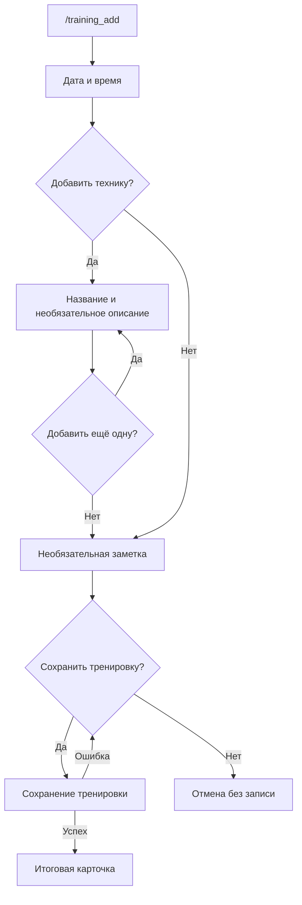
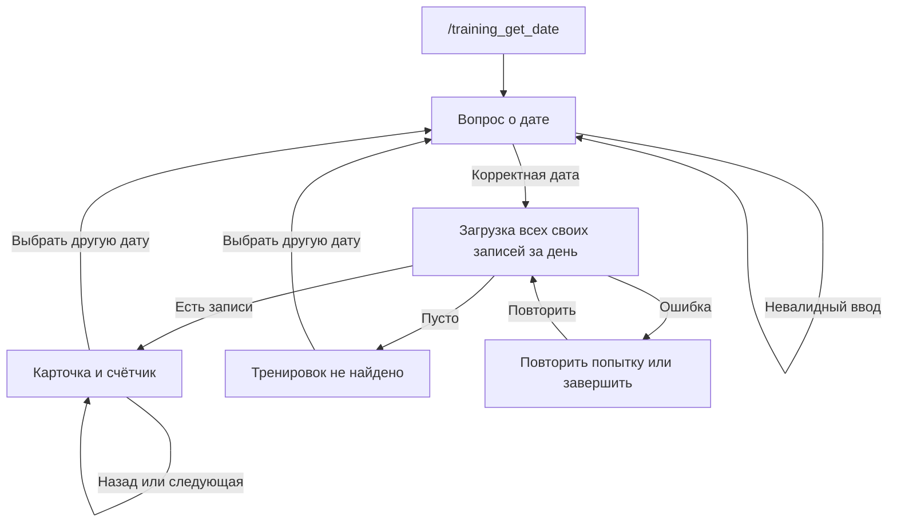
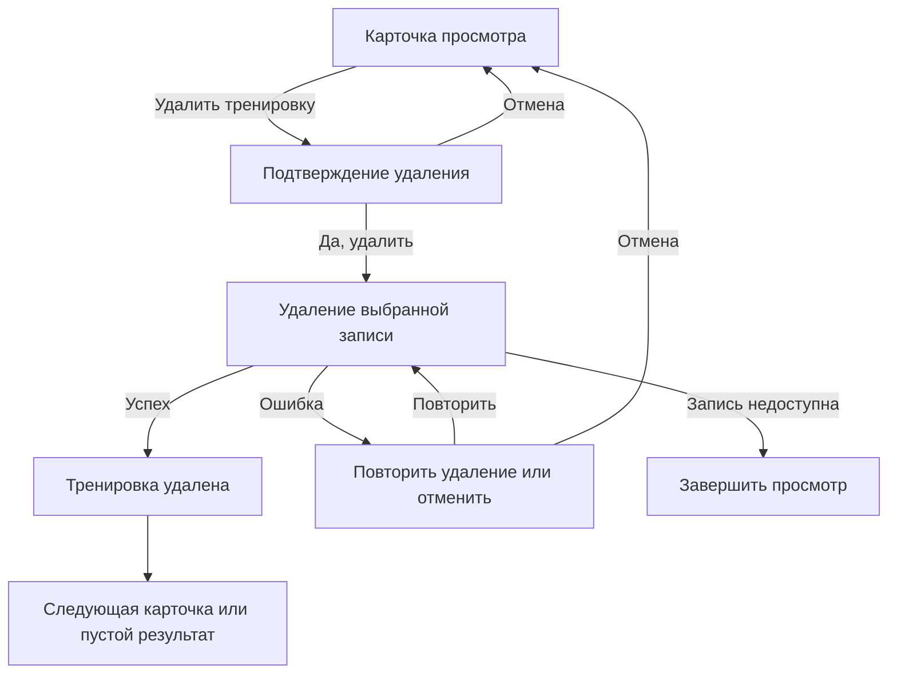

# Пользовательские пути MVP

[README](../README.md) · [Архитектура](architecture.md) · [Разработка](development.md) · [Развёртывание](deployment.md)

## Начало работы

Дневник работает в личном чате. `/start` показывает приветствие и предлагает
заполнить необязательный профиль через `/profile`, даже до первой тренировки.
`/help` показывает справку.
Эти две команды не сбрасывают текущий сценарий.
Полный список команд приведён в [README](../README.md#команды).

В сценариях дневника вопросы и карточки редактируются в одном активном сообщении.
Повторный `/training_add`, восстановление отсутствующего сообщения и подтверждение
`/cancel_all` создают новые сообщения. Старые сообщения могут остаться
в чате, если Telegram отказал в очистке.

## Создание тренировки

**Вход:** `/training_add`. У пользователя может быть только один незавершённый
черновик. Команда сначала закрывает активный просмотр.

| Шаг | Действие пользователя | Результат |
|---|---|---|
| Дата | Ввести дату проведения | Вопрос о времени |
| Время | Ввести время начала | «Добавить технику?» |
| Техники | «Да» — ввести название; «Нет» — пропустить | Для названия появляется вопрос об описании |
| Описание | «Да» — ввести описание; «Нет» — оставить без описания | «Добавить ещё одну технику?» |
| Ещё техника | «Да» — повторить ввод; «Нет» — закончить список | Вопрос о заметке |
| Заметка | «Да» — ввести заметку; «Нет» — пропустить | «Сохранить тренировку?» |
| Подтверждение | «Да» | Сохранение тренировки и итоговая карточка |
| Отказ от сохранения | «Нет» | Создание отменяется без сохранения |

Техники могут повторяться по названию: это отдельные элементы списка.
Тренировка без техник также допустима. Если пользователь согласился ввести
название, описание или заметку, пустой текст отклоняется; необязательные поля
пропускаются соответствующей кнопкой, а не пустым сообщением.

На шагах с выбором используются inline-кнопки «Да» и «Нет», а не текстовые ответы.
Обработанный ввод удаляется после успешного показа следующего вопроса или ошибки
валидации. Если ответ не появился, введённые данные уже могли попасть в черновик.
Вызовите `/training_add`, чтобы увидеть текущий шаг.

### Форматы ввода

Дата: `ДД.ММ.ГГГГ` или `ГГГГ-ММ-ДД`; для обоих порядков допустимы одинаковые
разделители `.`, `/`, `-`. День и месяц — по две цифры, год — четыре.
Примеры: `15.10.2026`, `2026/10/15`, `15-10-2026`.
Пробелы по краям убираются; невозможные даты, например `31.02.2026`, отклоняются.
Для поиска по дате действуют те же правила.

Время: `Ч:ММ` или `ЧЧ:ММ`, также с дефисом, например `8:00`, `19:30`, `8-00`.
Минуты вводятся двумя цифрами. Дата и время сохраняются как введённые календарные
значения, без выбора часового пояса и пересчёта в UTC.

### Календарь даты

Календарь создания доступен для `/training_add` при включённом флаге
`TRAINING_DATE_CALENDAR_ENABLED=true`. По умолчанию флаг выключен и вопрос даты
остаётся прежним текстовым. Для календаря поиска используется отдельный флаг;
ввод времени и профиль не меняются.

На шаге даты сразу открывается текущий месяц по системным часам сервера.
Неделя начинается с понедельника. «‹» и «›» переключают месяц; название месяца
открывает выбор месяца, год — выбор года. Годы выбираются страницами по 12,
затем выбираются месяц и день. «Назад» возвращает с выбора года к месяцам,
с выбора месяца — к календарной сетке, без сохранения даты.

Нажатие дня сразу переводит к существующему вводу времени, без подтверждения.
Будущие даты разрешены. Кнопок «Сегодня» и «Вчера» нет. На любом уровне можно
просто отправить дату текстом в [прежнем формате](#форматы-ввода).
Ошибка ручного ввода сохраняет показанный месяц и уровень календаря.

Навигация редактирует существующий вопрос. Повторный `/training_add` по прежним
правилам присылает новый вопрос, сохраняя месяц и уровень незавершённого выбора.
Если сообщение удалено, бот отправляет замену. При обычной ошибке Telegram
прежние кнопки навигации остаются доступны для повторной попытки. Если день уже
принят, но вопрос времени не отобразился, `/training_add` восстановит шаг времени.
Устаревшие, повторные и чужие кнопки не выбирают дату; команды отмены работают
как на остальных шагах создания.

Календарь поддерживает четырёхзначные годы 0000–9999; ручной парсер не изменён.
Месяц и уровень хранятся в памяти вместе с текущим вопросом и теряются при рестарте.
Пользовательские часовые пояса не добавлены; выбранная дата остаётся `LocalDate`.
Включение и выключение флага описано в [настройках](development.md#календарь-даты-тренировки).

### Выбор времени кнопками

При `TRAINING_TIME_PICKER_ENABLED=true` после даты отображаются часы `00–23`,
затем минуты `00`, `15`, `30`, `45`. Выбор минут сразу переводит к вопросу
о добавлении техники. «Назад» возвращает к часам, не записывая время в черновик.
Кнопка отмены доступна на обоих экранах.

На обоих экранах можно отправить время текстом в прежнем формате. Минуты ручного
ввода не округляются. Ошибка сохраняет экран и выбранный час; предупреждение с одним
`⚠️` отображается после инструкции, непосредственно над кнопками. Прокруткой
управляет Telegram, поэтому это не гарантирует видимость на каждом устройстве.

Навигация изменяет существующее сообщение. Повторный `/training_add` отправляет
новый видимый вопрос, сохраняя экран минут и выбранный час. Устаревшие кнопки
не действуют. Если навигация временно не удалась, прежние кнопки доступны для
повторной попытки; недоступное сообщение заменяется. Если время принято,
а следующий вопрос не показан, `/training_add` восстановит следующий шаг.
При ошибке отправки можно повторить команду. После перезапуска временный черновик
и выбор часа теряются; сохранённые тренировки остаются в БД.

Флаг по умолчанию выключен и независим от календарей: без него работает прежний
текстовый шаг. [Настройка флага](development.md#выбор-времени-тренировки).

### Повторный вход, ошибка и завершение

Повторный `/training_add` сохраняет черновик и присылает **новый видимый вопрос
его текущего шага**. Он позволяет продолжить незавершённую тренировку или восстановить
вопрос, который пользователь скрыл у себя; старые кнопки теряют актуальность.
Только после успешной отправки и регистрации нового вопроса бот пытается удалить
предыдущий. При отказе удаления он пробует убрать старые кнопки; если очистка
не удалась, старое сообщение может остаться видимым, но его кнопки уже не действуют.
Ошибка очистки не отменяет восстановление и не теряет черновик. При ошибке
отправки нового вопроса прежний вопрос не удаляется; команду можно повторить.

При ошибке записи данные остаются в черновике, бот возвращает возможность
подтвердить сохранение. Успешная запись завершает создание; итог —
«Тренировка сохранена.» и свёрнутая цитата с данными. В этой итоговой карточке
нет кнопки удаления: для удаления сначала откройте запись командой просмотра.
Если запись сохранилась, а Telegram не показал итог, повторно создавать такую же
тренировку не нужно: сначала проверьте `/training_get_last` или поиск по дате.

Кнопка «Отменить тренировку» отменяет только создание. `/cancel` сначала закрывает
просмотр, если он открыт, и лишь при его отсутствии отменяет создание.
Во время уже начатого сохранения обычная отмена может быть отклонена.

Исходники: [команда создания](../src/main/kotlin/morningpilates/telegram/training/command/TrainingAddCommand.kt),
[вопросы и кнопки](../src/main/kotlin/morningpilates/telegram/training/creation/TrainingCreationPrompts.kt),
[обработка ввода](../src/main/kotlin/morningpilates/telegram/training/creation/TrainingCreationTextHandler.kt),
[переходы создания](../src/main/kotlin/morningpilates/training/TrainingFlowService.kt).

## Просмотр последней тренировки

**Вход:** `/training_get_last`. Последняя запись определяется датой проведения,
затем временем начала, затем временем добавления — по убыванию. Это не просто
последняя добавленная запись, если пользователь записал старую тренировку.

При наличии записи показывается карточка с кнопками «Удалить тренировку» и
«Завершить просмотр». При пустом дневнике — «Тренировок пока нет…» без кнопок.
При ошибке чтения — сообщение об ошибке, «Повторить попытку» и «Завершить просмотр».
Повтор выполняет новое чтение последней тренировки.

Команда переиспользует существующее сообщение просмотра и может работать
одновременно с незавершённым созданием. Просмотр не изменяет его черновик.
При закрытии просмотра кнопкой или `/cancel` отдельное сообщение о завершении
не отправляется.

## Поиск по дате

При включённом `TRAINING_SEARCH_DATE_CALENDAR_ENABLED=true` команда сразу показывает
календарь текущего месяца по системным часам сервера. Навигация по месяцам и годам
совпадает с [календарём создания](#календарь-даты); день сразу запускает поиск.
Текстовую дату можно отправить на любом уровне. Ошибка ввода сохраняет месяц
и уровень навигации. Предупреждение с одним `⚠️` располагается после инструкции,
непосредственно над inline-календарём, и исчезает после корректного ввода.
Это не гарантирует видимость: прокруткой управляет клиент Telegram.
Будущие даты доступны; часовые пояса не добавляются.

Навигация изменяет существующее сообщение. Недоступное для редактирования
сообщение заменяется, старые кнопки теряют актуальность. Временная ошибка Telegram
не создаёт новый вопрос. Повторный `/training_get_date` отправляет новый видимый
календарь текущего месяца, даже если прежнее сообщение скрыто только на клиенте.
Старые кнопки после успешной отправки не действуют. При ошибке отправки состояние
сохраняется, команда остаётся в чате; её можно повторить. «Выбрать другую дату»
открывает текущий месяц в существующем сообщении. Если результат поиска не удалось отобразить,
повторный вызов команды позволяет начать поиск снова. `/cancel` и `/cancel_all`
закрывают календарь; после перезапуска временный поиск нужно открыть заново.

Флаг по умолчанию выключен; ниже описан прежний текстовый вход и общий просмотр
результатов, одинаковый для обоих способов выбора даты.

**Вход:** `/training_get_date`. Бот задаёт вопрос
«Введите дату тренировки. Формат: ДД.ММ.ГГГГ» и показывает «Завершить просмотр».

Если создание ещё не закончено, поиск не запускается. Предупреждение добавляется
к текущему вопросу создания; черновик и его кнопки сохраняются. Следующее действие
создания убирает предупреждение.

При ошибочной дате предупреждение появляется над полным вопросом в том же
сообщении. Корректный ввод убирает ошибку. После успешного показа результата
обработанный текст удаляется; при отказе отображения его можно отправить снова.

| Результат | Отображение и действия |
|---|---|
| Несколько записей | «Тренировки за DD.MM.YYYY», «Тренировка N из M», карточка, удаление, выбор даты и завершение |
| Одна запись | Та же карточка без перелистывания |
| Нет записей | «За DD.MM.YYYY тренировок не найдено.», выбор другой даты и завершение |
| Ошибка загрузки | «Не удалось загрузить тренировки. Попробуйте ещё раз.», повтор и завершение |

Сначала показываются более поздние тренировки по времени проведения; при
одинаковом времени — позже добавленные. У первой карточки нет «Назад», у последней
нет «Следующая». Навигация не циклическая.

При перелистывании состав и порядок загруженного списка не меняются.
Чтобы обновить результаты, выберите дату заново. «Повторить попытку» после ошибки
повторяет поиск по уже выбранной дате.

При выключенном флаге повторный `/training_get_date` возвращает к текстовому
вопросу в том же сообщении. При включённом — отправляет новый календарь.
`/training_get_last` переключает это сообщение на последнюю тренировку и прекращает
ожидание даты. Обратное переключение возвращает к поиску. Старые кнопки прежнего
состояния не управляют новым просмотром.

Исходники: [поиск по дате](../src/main/kotlin/morningpilates/telegram/training/command/TrainingGetDateCommand.kt),
[ввод даты](../src/main/kotlin/morningpilates/telegram/training/view/TrainingDateTextHandler.kt),
[состояние поиска](../src/main/kotlin/morningpilates/telegram/training/view/TrainingDateSearch.kt),
[карточки и навигация](../src/main/kotlin/morningpilates/telegram/training/view/TrainingDateViewReply.kt).

## Удаление записи

Удаление доступно только из карточки просмотра сохранённой записи. Дата и время
в подтверждении помогают проверить выбор. Удаляется только выбранная запись:
другая тренировка с такими же датой и временем остаётся.

После «Удалить тренировку» то же сообщение показывает:

> Удалить тренировку за DD.MM.YYYY в HH:mm? Это действие нельзя отменить.

«Да, удалить» выполняет удаление. «Отмена» возвращает исходную карточку;
для поиска сохраняются дата, список и позиция. После отмены старое подтверждение
не действует, даже если открыть удаление этой же записи заново.

### После успеха

В сообщении появляется «Тренировка удалена.»; просмотр не закрывается автоматически.

| Режим | Что происходит дальше |
|---|---|
| Поиск по дате | Запись убирается из загруженного списка. Показывается следующая, а после удаления последней — предыдущая. Счётчик и кнопки обновляются |
| Единственная запись за дату | Пустой результат с выбором другой даты и завершением |
| Последняя тренировка | Показывается последняя оставшаяся запись; если дневник опустел, появляется штатное сообщение без кнопок |

### Ошибки

| Ситуация | Ответ | Дальнейшее действие |
|---|---|---|
| Ошибка удаления | «Не удалось удалить тренировку. Попробуйте ещё раз.» | «Повторить удаление» относится к той же записи; «Отмена» возвращает исходную карточку |
| Удаление успешно, следующая последняя запись не загрузилась | «Тренировка удалена. Не удалось загрузить следующую тренировку.» | «Повторить попытку» повторяет только загрузку, не удаление; есть завершение |
| Выбранная запись недоступна | «Тренировка больше недоступна.» | Только «Завершить просмотр» |
| Telegram не показал результат удаления | Старый экран может остаться видимым | Удаление не отменяется; старое подтверждение не удаляет запись повторно. Восстановите экран командой просмотра или завершите действие |

На подтверждении `/cancel` закрывает просмотр, `/cancel_all` сбрасывает действия,
а `/training_add` переходит к созданию. Эти команды сами по себе не подтверждают
удаление. Работа с сохранённой записью через просмотр последней не изменяет
параллельный черновик.

Исходники: [удаление](../src/main/kotlin/morningpilates/telegram/training/view/TrainingViewDeletion.kt),
[тексты и кнопки](../src/main/kotlin/morningpilates/telegram/training/view/TrainingViewContent.kt).

## Отмена и восстановление

| Действие | Область действия |
|---|---|
| «Отменить тренировку» | Только незавершённое создание |
| «Отмена» на подтверждении удаления или его ошибке | Только намерение удалить; возвращает к карточке |
| «Завершить просмотр» | Только просмотр |
| `/cancel` | Сначала профиль или просмотр, если есть; иначе создание. Без действий отвечает «Нет активного действия.» |
| `/cancel_all` | Профиль, создание и просмотр текущего пользователя вместе; отправляет новое видимое подтверждение даже при отсутствии действий |

Если одновременно открыты создание и просмотр последней тренировки, первый
`/cancel` закрывает просмотр, второй отменяет создание. `/cancel_all` делает сброс
за один вызов; сохранённые записи он не удаляет.

После перезапуска незавершённые действия не восстанавливаются. Нажатие распознанной
кнопки прежнего запуска получает уведомление
«Этот диалог больше неактуален. Используйте меню команд.» и не выполняет действие.
Начните заново командой. Устаревшая кнопка текущего запуска может быть проигнорирована
без отдельного уведомления.

Исходники: [cancel](../src/main/kotlin/morningpilates/telegram/command/CancelCommand.kt),
[cancel_all](../src/main/kotlin/morningpilates/telegram/command/CancelAllCommand.kt),
[подтверждение callback](../src/main/kotlin/morningpilates/telegram/api/CallbackAcknowledgement.kt).

## Личный профиль спортсмена

`/profile` доступен каждому пользователю в личном чате, в том числе до первой
тренировки. Все поля необязательны и заполняются по отдельности; пустые значения
показываются прочерками.

### Просмотр и редактирование

1. `/profile` показывает актуальную карточку с единственной кнопкой «Редактировать».
2. «Редактировать» показывает кнопки доступных полей и «Завершить редактирование».
3. Выбор поля показывает вопрос в той же карточке и скрывает кнопки других полей.
   Для фиксированных значений остаются только варианты этого поля, для текстового
   ввода — инструкция. Дополнительно доступны «Очистить» и «Назад».
   «Назад» возвращает к списку полей без изменения данных; кнопка завершения
   редактирования доступна только в списке полей.
4. После изменения/очистки поля бот возвращается к списку полей, сохраняя режим
   редактирования. После ошибочного ввода остаётся на том же поле и предлагает повторить ввод.
5. «Завершить редактирование» возвращает к просмотру с одной кнопкой «Редактировать».

Ошибки ввода выделяются коротким предупреждением, например «⚠️ Некорректный вес.».
Под ним показывается одна инструкция без примеров и повторений. Карточка остаётся
на выбранном поле с кнопками «Назад» и «Очистить».

Режимы, данные, вопросы и ошибки валидации обновляются в **одном сообщении бота**.
Повторный `/profile` перечитывает данные из БД и возвращает эту карточку к просмотру,
отменяя незавершённый ввод. Только если Telegram сообщает, что карточка удалена,
бот отправляет её замену. Кнопки прежней карточки не получают авторизацию.

После успешного отображения карточки бот пытается удалить команду `/profile`.
После сохранения текстового значения бот пытается удалить сообщение с вводом,
даже если Telegram не смог показать результат сохранения. Некорректный ввод также
удаляется после успешного показа ошибки в карточке; сохранённые данные не меняются.
Ошибка удаления не прерывает редактирование и не откатывает БД. При ошибке записи
значение не считается сохранённым: после отображения ошибки сообщение с вводом
также удаляется, а выбранное поле остаётся доступным для повторного ввода.
Если показать ошибку не удалось, сообщение пользователя остаётся в чате.
Автоматического повторного удаления сообщений нет.

### Поля

| Поле | Ввод и проверка |
|---|---|
| Имя, фамилия | Два независимых поля, 1–50 символов без управляющих символов; пробелы по краям удаляются; значения не берутся из Telegram |
| Дата рождения | Точная существующая дата `ДД.ММ.ГГГГ`, год от 0001, не позднее сегодняшнего дня |
| Вес | Килограммы, больше 0 и не более 150; до двух знаков после точки или запятой |
| Пояс BJJ | Кнопки: белый, синий, пурпур, коричневый, чёрный |
| Страйпы | Для белого, синего, пурпурного и коричневого пояса: целое число 0–4 |
| Дан | Для чёрного пояса: целое число 0–10 |
| Дата получения пояса | Доступна только при выбранном поясе; необязательная существующая дата `ДД.ММ.ГГГГ`, не из будущего |
| Начало занятий BJJ | Месяц и год `ММ.ГГГГ`, год от 0001, не позднее текущего месяца |

В карточке и редактировании отображается только подходящее поле отметок: «Страйпы»
или «Дан». Без выбранного пояса это поле отсутствует и ввод недоступен.
Ноль обозначает явно заданное отсутствие отметок; прочерк — незаполненное значение.
Любая смена цвета пояса сбрасывает отметки и дату получения прежнего пояса;
очистка пояса очищает оба зависимых значения. Повторный выбор того же цвета
сохраняет значения.

Возраст рассчитывается в полных годах на день просмотра. Стаж — разница календарных
месяцев с месяцем первого занятия, отображаемая годами и месяцами. Эти показатели
не хранятся как фиксированные числа. Истории веса, поясов и отметок нет.

### Совместимость с дневником и восстановление

Для предотвращения смешивания текстового ввода `/profile` отказывает во время
создания тренировки или ожидания даты поиска. Весь режим редактирования профиля,
включая выбор следующего поля, блокирует `/training_add`, `/training_get_date`
и `/training_get_last` с предложением завершить редактирование или использовать
`/cancel`. Просмотр профиля не блокирует дневник. Переход в профиль закрывает
пассивный просмотр тренировки; переход из просмотра профиля к дневнику закрывает
профиль. Существующий черновик тренировки при отказе не изменяется.

`/cancel` закрывает профиль вместе с несохранённым вводом; `/cancel_all` также
сбрасывает его. Старые кнопки после переключения режима, смены вопроса, отмены
или перезапуска не выполняют действий. Кнопки проверяются по пользователю, чату,
сообщению, токену и разрешённым действиям текущего режима.
Пользователь видит и изменяет только свой профиль.

При ошибке БД бот сообщает об ошибке, а не показывает пустой профиль. Ошибка
сохранения позволяет повторить ввод. Успешная запись в БД не откатывается при ошибке
доставки Telegram: `/profile` заново загрузит данные. Принятое завершение/сброс
редактирования и сохранение инвалидируют прежние действия до обновления Telegram.
После рестарта сохранённые поля остаются в PostgreSQL; незавершённый ввод теряется.
Удаления всего профиля, доступа тренеров, клубов, детских профилей и истории изменений нет.

## Ограничения

Незавершённые действия хранятся только в памяти. Отмена не откатывает уже выполненное
сохранение или удаление; `/cancel_all` не гарантирует остановку начатого сохранения.
Удаление необратимо, корзины нет. Если Telegram не показал результат операции,
проверьте сохранённые записи новой командой просмотра.

Длинная карточка не разбивается автоматически на несколько сообщений: ограничения
Telegram могут помешать её отправке. Нет экспорта, редактирования сохранённых
тренировок, поиска по техникам, статистики, платежей и напоминаний.
